# Documentación correspondiente a la entrega de las optimizaciones.
La implementación de las optimizaciones se encuentran en el path: `/proyecto/optimizaciones` en los archivos:<br> 
- `constant_propagation.h/.c`
- `dead_code_elimination.h/.c`
- `reuse_offsets.h/.c`

**Nota**: las imágenes que presentadas a continuación se generaron ejecutando el comando `dot -Tsvg file.dot -o ast.svg` sobre el archivo `.dot` que genera el compilador. Los archivos `.dot` se almacenan en la carpeta `./dot_files` y se generan con el mismo nombre que el archivo a compilar.

## Propagación de constantes
La implementación se encuentra en la carpeta `/optimizaciones` en los archivos `constant_propagation.h/.c`.<br> La idea que se siguio fue que al llegar a un nodo que representa una expresión aritmetica (`+`, `-`, `*`, `/`, `%`), una expresión de comparación (`<`, `>`, `==`) o una expresión lógica (`&&`, `||`) se chequea si los 2 operandos son constantes, si ese es el caso entonces se resuelve la expresión y se libera el subarbol del ast de la misma para reemplazarlo con un nodo de tipo constante que es el resultado de evaluar la expresión.<br>
Tambien se realizo propagación de constantes en expresiones a las que se le aplica un operador unario como el menos unario `-` y la negación `!`. En estos casos se chequea si el operando es una constante y si es asi se resuelve la operación liberando tambien el nodo del ast y reemplazandolo por el de una constante producto de evaluar la expresión.<br>
Otro detalle es que ya sea en el caso de una expresión de un operador binario o unario primero se analiza recursivamente el operando ya que este a su vez podria ser otra expresión que quiza se le pueda aplicar propagación de constantes tambien.

<br>**Funciones**<br>
<br>Función recursiva principal que toma la raiz del ast y llama a diferentes funciones para cada tipo de nodo.
```
void constantPropagation(AstNode **root);
```

Funciones para procesar cada tipo de nodo del ast.

```
void constantPropagationNodeMethodDeclList(AstNode **node);
void constantPropagationNodeMethodDecl(AstNode **node);
void constantPropagationNodeStatements(AstNode **node);
void constantPropagationNodeAssignment(AstNode **node);
void constantPropagationNodeMethodCall(AstNode **node);
void constantPropagationNodeIfElse(AstNode **node);
void constantPropagationNodeWhile(AstNode **node);
void constantPropagationNodeReturn(AstNode **node);
void constantPropagationNodeListExpr(AstNode **node);
void constantPropagationNodeAddition(AstNode **node);
void constantPropagationNodeSubtraction(AstNode **node);
void constantPropagationNodeMultiplication(AstNode **node);
void constantPropagationNodeDivision(AstNode **node);
void constantPropagationNodeMod(AstNode **node);
void constantPropagationNodeComparisonSmaller(AstNode **node);
void constantPropagationNodeComparisonGreater(AstNode **node);
void constantPropagationNodeEqual(AstNode **node);
void constantPropagationNodeAnd(AstNode **node);
void constantPropagationNodeOr(AstNode **node);
void constantPropagationNodeMinus(AstNode **node);
void constantPropagationNodeNegation(AstNode **node);
```

Funciones auxiliares para hacer propagación de constantes en nodos de expresiones aritmeticas, de comparación y lógicas.
```
void constantPropagationNodeArithmeticBinaryOperation(AstNode **node);
void constantPropagationNodeComparison(AstNode **node);
void constantPropagationNodeBooleanBinaryOperation(AstNode **node);
```

**Ejemplo 1**:
```
void main() {
    int x;
    boolean a, b;

    x = (1 + 2) * (8 / 4);
}
```
**Ast sin aplicar la propagación de constantes**:
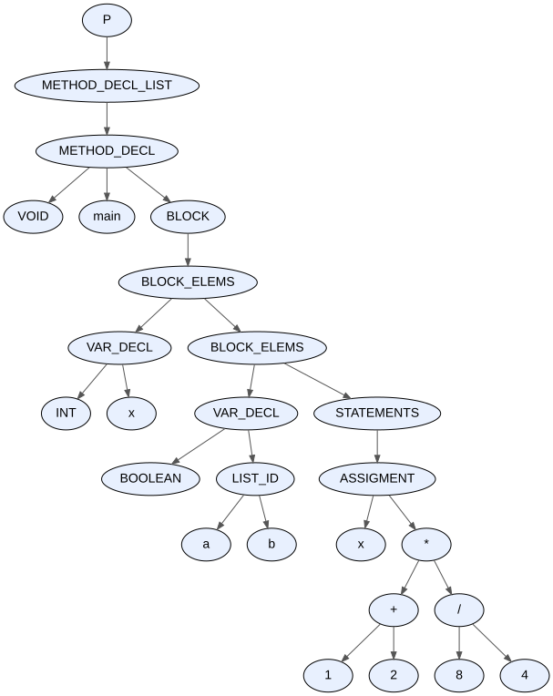

<br>**Ast aplicando la propagación de constantes**:
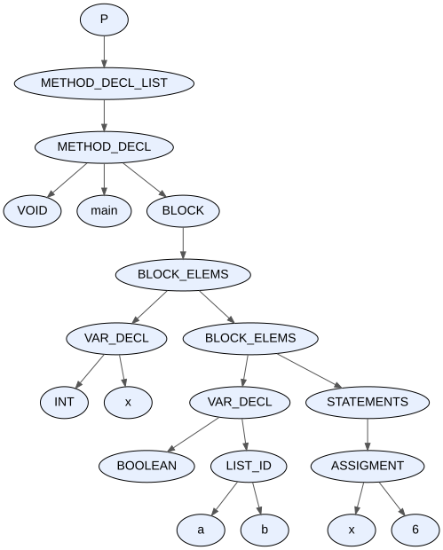

<br><br>**Ejemplo 2**:
```
void main() {
    boolean a, b;

    a = (2 + 8 < 20);
    b = (4 == (6 - 1));
}
```

**Ast sin aplicar la propagación de constantes**:
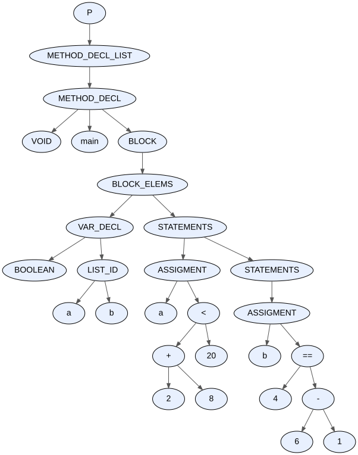

<br>**Ast aplicando la propagación de constantes**:
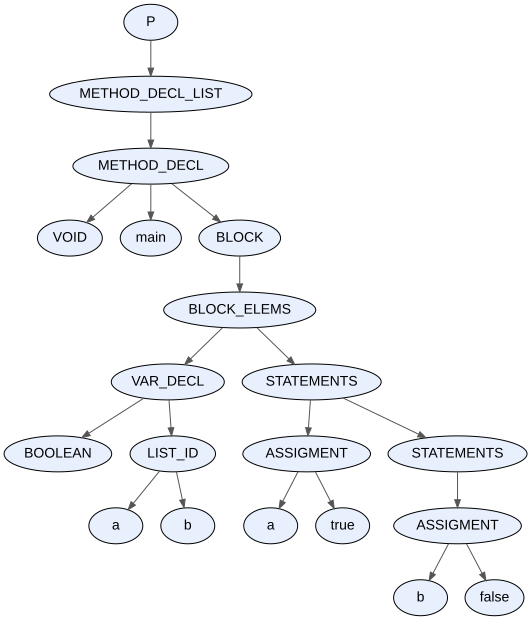

<br><br>**Ejemplo 3**:
```
void main() {
    int x;
    boolean a;

    x = -(4 * 2);
    a = !(true && false);
}
```

**Ast sin aplicar la propagación de constantes**:
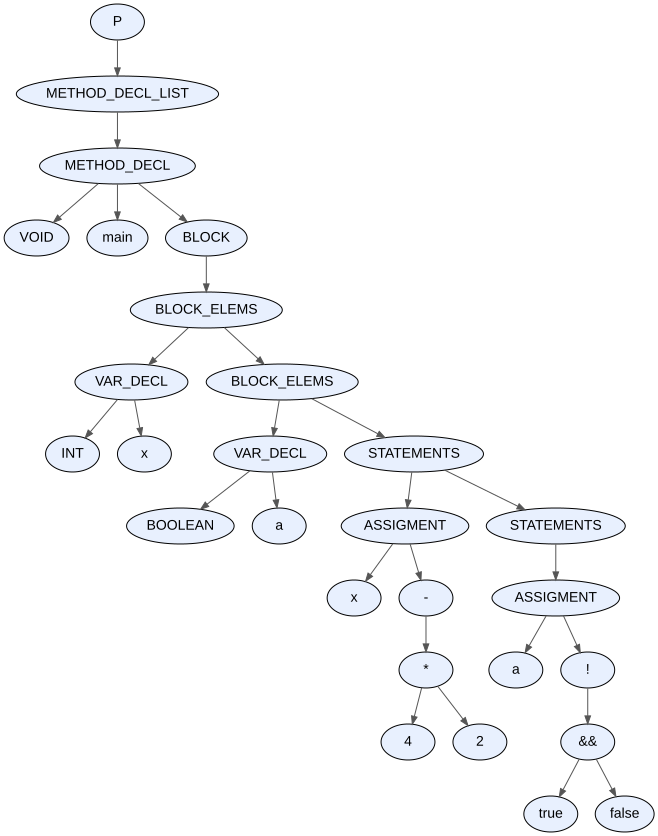

<br>**Ast aplicando la propagación de constantes**:
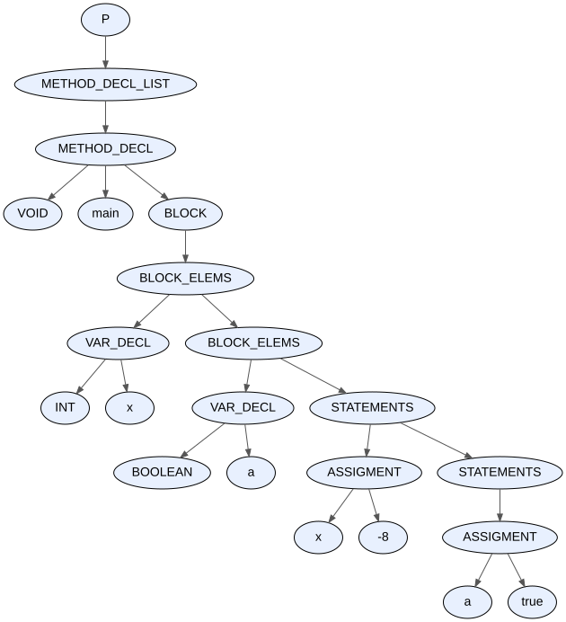

## Eliminación de código muerto
La implementación se encuentra en la carpeta `/optimizaciones` en los archivos `dead_code_elimination.h/.c`. La eliminación de código muerto actua de la siguiente forma:<br> 
- Cada vez que se encuentra con una sentencia `if` chequea si la condición es una constante y si es asi se queda con el bloque de la rama correspondiente y borra la otra en el ast. Terminaria eliminando el subarbol del if y reemplzandolo por el otro subarbol que es el bloque de la rama que se va a a ejecutar.
- Con una sentencia de tipo `while` corroboro si la condición es una constante. Si es asi entonces si la condición es true entonce simplemente emito un warning de ciclo infinito y si es false elimino el subarbol del ast correspondiente al ciclo while ya que nunca se ejecutara.
- En una sentencia `return` chequeo si luego de la misma hay mas sentencias en el bloque que se encuentra. Si es asi elimino todas las sentencia que le siguen al return dentro del mismo bloque o sub-bloques internos.

<br>**Funciones**:
<br>Función recursiva principal que toma la raiz del ast y de acuerdo al tipo de nodo llama a otras funciones.
```
void deadCodeElimination(AstNode **root);
```

Funciones para analizar diferentes tipos de nodos.
```
void deadCodeEliminationNodeMethodDeclList(AstNode **node);
void deadCodeEliminationNodeStatements(AstNode **node);
bool deadCodeEliminationNodeIfElse(AstNode **node);
bool deadCodeEliminationNodeWhile(AstNode **node);
```

<br>**Ejemplo 1**:
```
void main() {
    int x;

    if (true) {
        x = 1;
    } else {
        x = 2;
    }
}
```

<br>**Ast sin aplicar eliminación de código muerto**:
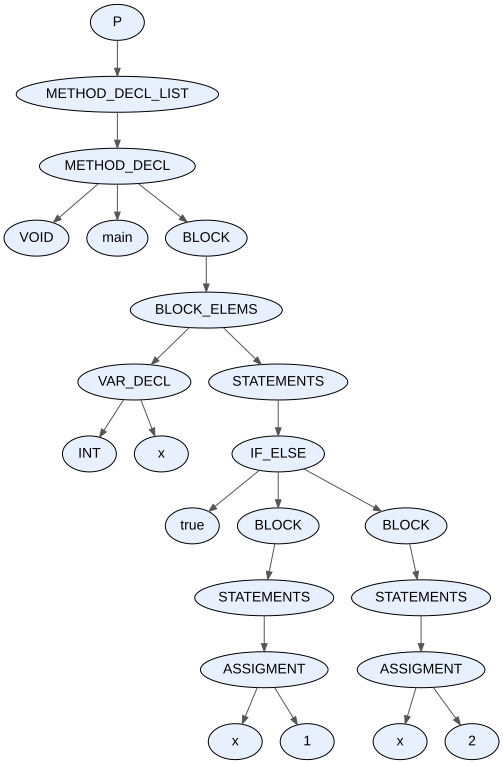

<br>**Ast aplicando eliminación de código muerto**:
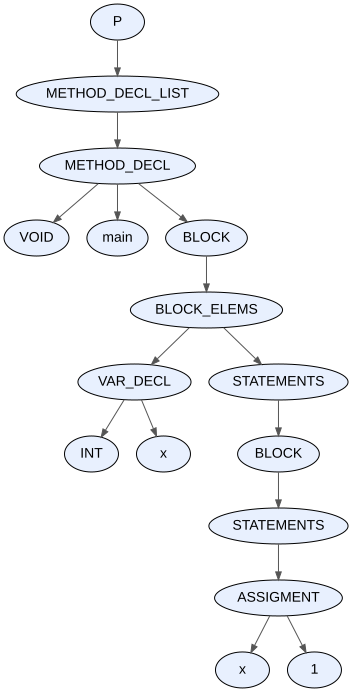

<br>**Ejemplo 2**:
```
void main() {
    int x, y;

    while (false) {
        x = x + 1;
    }

    y = 8;
}
```

<br>**Ast sin aplicar eliminación de código muerto**:
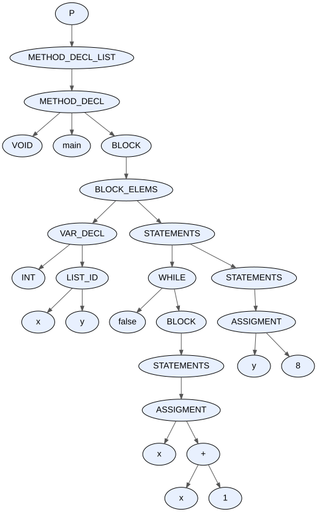

<br>**Ast aplicando eliminación de código muerto**:
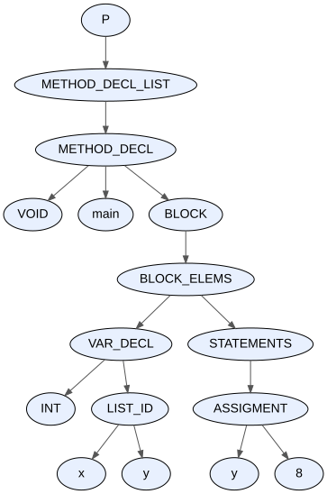

<br>**Ejemplo 3**:
```
int main() {
    int x;
    
    x = 1;
    return x;
    x = 2; 
}
```

<br>**Ast sin aplicar eliminación de código muerto**:
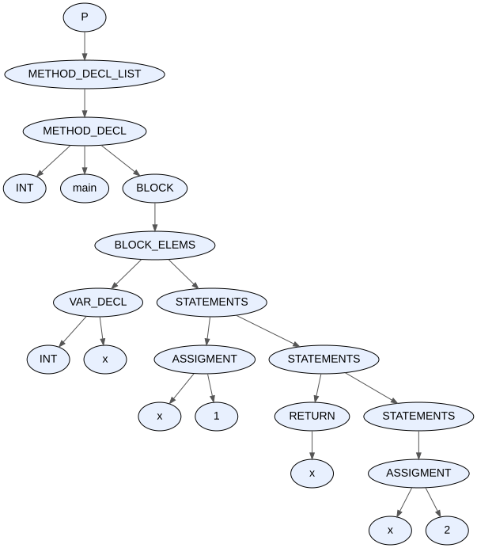

<br>**Ast aplicando eliminación de código muerto**:
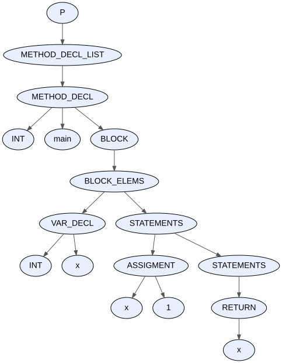

## Reuso de offsets
La implementación se encuentra en la carpeta `/optimizaciones` en los archivos `reuse_offsets.h/.c`. La idea para implementar esto es por un lado mantener una variable llamada currentOffset inicializada en -8 que indica cual es el proximo offset libre para asignar a un simbolo. Cada vez que a un simbolo se le asigna el valor de currentOffset, este se decrementa en -8. Entonces toda la logica para reusar los offsets se realiza en los nodos de tipo bloque en donde basicamente antes de ingresar al bloque se guarda el valor de currentOffset en una variable (oldCurrentOffset = currentOffset) y luego se ingresa al bloque en donde se puede seguir asignado valores de offset a las variables que tenga drecrementando el valor de currentOffset. Luego al salir del bloque lo que se hace es restaurar el valor de currentOffset con el valor de oldCurrentOffset.
<br><br>El siguiente pseudocódigo ejemplifica los descripto anteriormente:
```
currentOffset = -8;
{   
    // a x se le asigna offset -8 y se decrement currentOffset (vale -16)
    int x;

    oldCurrentOffset = currentOffset;
    
    {
        // a y se le asigna offset -16 y se decrementa currentOffset (vale -24)
        int y;

        // a y se le asigna offset -16 y se decrementa currentOffset (vale -32)
        int z;
        ...
    }

    currentOffset = oldCurrentOffset; // currentOffset vuelve a valer -16

    // se vuelve a guardar el valor de currentOffset porque hay un nuevo bloque
    oldCurrentOffset = currentOffset;
    {
        // se le asigna offset -16 y se decrementa currentOffset (vale -24)
        int w;
        ...
    }

    currentOffset = oldCurrentOffset; // currentOffset vuelve a valer -16
    ...
}
```

Esta implementación simple cumple que siempre se van a reusar los offsets porque al salir de un bloque todas las variables decalradas alli 'mueren' por ende se podria reusar su offsets y esto es equivalente a que currentOffset vuelva a tener el mismo valor que tenia antes de ingresar al bloque.

<br>**Funciones**
<br><br>Función principal que toma la raiz del ast y crea una variable llamada `currentOffset` inicializada con -8 que representa el proximo offsets libre a asignar a un simbolo. Luego llama a la función auxiliar `setOffsetsInAstWithReuseAux` y le pasa la raiz del ast y la referencia a la variable currentOffset.
```
void setOffsetsInAstWithReuse(AstNode *root);
```

Función auxiliar que recorre el ast llamando a diferentes funciones para los diferentes tipos de nodos. El objetivo es recorrer el ast ahsta encontrar un bloque y ahi poder aplicar la tecnica descripta anteriormente.
```
void setOffsetsInAstWithReuseAux(AstNode *node, int *currentOffset);
```

Funciones para diferentes tipos de nodos. Las mas importantes son `setOffsetsNodeBlock` la cual hace el trabajo para reusar los offsets.
```
void setOffsetsNodeMethodDeclList(AstNode *node, int *currentOffset);
void setOffsetsNodeVarDecl(AstNode *node, int *currentOffset);
void setOffsetsNodeBlock(AstNode *node, int *currentOffset);
void setOffsetsNodeBlockElems(AstNode *node, int *currentOffset);
void setOffsetsNodeStatements(AstNode *node, int *currentOffset);
void setOffsetsNodeIfElse(AstNode *node, int *currentOffset);
void setOffsetsNodeMethodDecl(AstNode *node, int *currentOffset);
void setOffsetsNodeMethodCall(AstNode *node, int *currentOffset);
void setOffsetsNodeListExpr(AstNode *node, int *currentOffset);
void setOffsetsNodeWhile(AstNode *node, int *currentOffset);
void setOffsetsNodeReturn(AstNode *node, int *currentOffset);
```

Funciones auxiliares para resetear el offset a temporales correspondientes a nodos de expresiones aritmeticas/logicas o de comparación.
```
void setOffsetsNodeBinaryOperator(AstNode *node, int *currentOffset);
void setOffsetsNodeUnaryOperator(AstNode *node, int *currentOffset);
```

Función auxiliar para obtener el numero de variables locales (y temporales) de un metodo.
```
void getNumberOfLocalVariablesAndTemporals(AstNode *node, int *numberOfVarsAndTemps);
```

Para esta última función agregue un campo mas a la estructura de los simbolos para que cada vez que encuentre una variable en el ast la cuente y la pueda marcar para no volver a contarla si aparece de nuevo en otra expresión.
```
typedef struct Symbol {
    ...
    bool marked;
} Symbol
```

<br>**Ejemplo 1**:
```
void main() {
    int x;
    x = 1;

    {
        int y, z;
        y = 4;
        z = 4 / y;
    }

    {
        int w;
        w = -x;
    }
}
```

**Salida en la terminal al ejecutar sin optimizaciones (en modo debug)**:<br> El simbolo t0 corresponde al resultado de la expresion `(4 / y)` y el simbolo t1 corresponde al resultado de la expresion `-x`.
```
[LOG_ASSEMBLY_GENERATION]: symbol x, offset: -8
[LOG_ASSEMBLY_GENERATION]: symbol y, offset: -16
[LOG_ASSEMBLY_GENERATION]: symbol t0, offset: -24
[LOG_ASSEMBLY_GENERATION]: symbol z, offset: -32
[LOG_ASSEMBLY_GENERATION]: symbol t1, offset: -40
[LOG_ASSEMBLY_GENERATION]: symbol w, offset: -48
```

**Salida en la terminal al ejecutar con el flag de optimizaciones**:
```
[LOG_REUSE_OFFSETS]: symbol x, offset: -8
[LOG_REUSE_OFFSETS]: symbol y, offset: -16
[LOG_REUSE_OFFSETS]: symbol z, offset: -24
[LOG_REUSE_OFFSETS]: symbol t0, offset: -32
[LOG_REUSE_OFFSETS]: symbol w, offset: -16
[LOG_REUSE_OFFSETS]: symbol t1, offset: -24
```

## Optimizaciones ad-hoc (shifteos al multiplicar o dividir por 2)
Finalmente realice una optimización simple que consiste en lo siguiente:
- Si en una multiplicación alguno de los dos operandos es la constante 2, entonces para calcular el resultado shifteo el otro operando un bit a la izquierda.
- En una división si el divisor es la constante 2, entonces para calcular el resultado shifteo un bit a la derecha el dividendo.
Esta optimización se aplica siempre (incluso si no se ejecuta el compialdor con la opción -opt).
<br><br>Para esto utilice las instrucciones `shl %reg` y `shr %reg` que shiftean valor almacenado en `reg` tantos bits como indique el valor almacenado en el registro `rcx`. 

<br>**Ejemplo 1**:
```
void main() {
    int x, y;
    x = 4;

    y = x * 2;
    y = x * 4;
}
```

**Assembly generado**:
```
.text

.globl main
main:
	enter $(8*4), $0

	# AssignmentIntInt
	mov $4, %r10
	mov %r10, -8(%rbp)

	# MultiplicationIntInt
	mov -8(%rbp), %r10
	mov $1, %rcx
	shl %r10 # optimization (faster than imul)
	mov %r10, -24(%rbp)

	# AssignmentIntInt
	mov -24(%rbp), %r10
	mov %r10, -16(%rbp)

	# MultiplicationIntInt
	mov -8(%rbp), %r10
	mov $4, %r11
	imul %r10, %r11
	mov %r11, -32(%rbp)

	# AssignmentIntInt
	mov -32(%rbp), %r10
	mov %r10, -16(%rbp)

	# note: setting rax with exit code 0 (even if main doesn't return anything)
	mov $0, %rax

.end_method_main:
	leave
	ret
```

<br>**Ejemplo 2**:
```
void main() {
    int x, y;
    x = 8;

    y = x / 2;
    y = 16 / x;
}
```

**Assembly generado**:
```

.text

.globl main
main:
	enter $(8*4), $0

	# AssignmentIntInt
	mov $8, %r10
	mov %r10, -8(%rbp)

	# DivisionIntInt
	mov -8(%rbp), %rax
	mov $1, %rcx
	shr %rax # optimization (faster than idiv)
	mov %rax, -24(%rbp) # save the quotient

	# AssignmentIntInt
	mov -24(%rbp), %r10
	mov %r10, -16(%rbp)

	# DivisionIntInt
	mov $16, %rax
	mov -8(%rbp), %r10
	cqto # extend rax sign to rdx
	idiv %r10
	mov %rax, -32(%rbp) # save the quotient

	# AssignmentIntInt
	mov -32(%rbp), %r10
	mov %r10, -16(%rbp)

	# note: setting rax with exit code 0 (even if main doesn't return anything)
	mov $0, %rax

.end_method_main:
	leave
	ret
```
